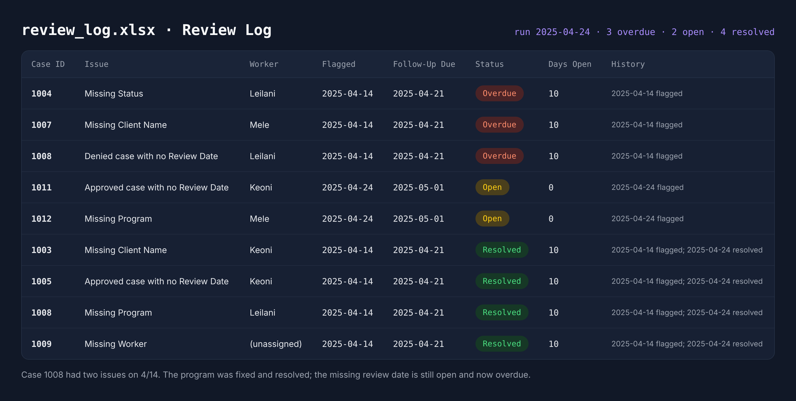

# 🔍 Eligibility Case Review Tracker

Python and Excel tool for tracking case review issues from the first flag to the fix. Built for QA and case review teams who need to know what is still open, who owns each fix, and which follow-ups are past due.

Each run checks case records for missing information, then updates a running review log in Excel. New issues get added with a follow-up due date. Issues still in the data carry forward and age. Issues no longer in the data are marked Resolved with the date. Reviewer notes typed into the log stay in place between runs.

## 🔧 What It Does

**Case checks**
- Flags records missing a Case ID, Client Name, Program, Status, or Worker (blank or space-only entries count as missing)
- Flags approved or denied cases with no review date (pending cases without one are allowed)
- Tracks each issue separately, so a case with two problems shows two log entries, and fixing one resolves only that entry

**Follow-up tracking across runs**
- Assigns every new issue a follow-up due date (7 days by default, set in `FOLLOW_UP_DAYS`)
- Marks open issues Overdue once the due date passes
- Marks issues Resolved when the next run no longer finds them, and records the resolution date and days open
- Reopens a resolved issue if the problem comes back, with the reopen date in the History column
- Keeps anything typed in the Reviewer Notes column from one run to the next

**Reporting**
- Summary sheet with run totals (cases checked, new, resolved, reopened) and issue counts by worker
- Worker counts are Excel `COUNTIFS` formulas, so they update if a reviewer edits the log
- Review Log sorted Overdue first, then Open, then Resolved, with color-coded status and filters on every column
- Cases This Run sheet showing each record with a Needs Review or OK status and notes

## 📊 Sample Output

Review Log after the second sample run (April 24). Three issues from April 14 passed their due date without a fix, four were fixed, and two new issues came in.

## 🧪 Sample Data

Two snapshots of the same caseload, ten days apart:

| File | Cases | What changes |
|---|---|---|
| `data/cases_2025-04-14.csv` | 10 | 6 cases with 7 issues: missing names (blank and spaces only), missing status, missing program, missing worker, decided cases with no review date |
| `data/cases_2025-04-24.csv` | 12 | Cases 1003, 1005, and 1009 fixed. Case 1008 has its program fixed but still no review date. Cases 1004 and 1007 untouched. New cases 1011 and 1012 arrive with issues |

In the first file, cases 1002 and 1006 are pending with no review date and are not flagged.

## 🧰 Tools Used

- Python 3 (pandas, openpyxl), AI-assisted development
- Microsoft Excel: input template with dropdowns and date validation, formatted output with `COUNTIFS` formulas, conditional formatting, filters, and frozen headers

## 📁 File Overview

- `review_tracker.py` - Checks the case file, updates the review log, and writes the Excel report
- `data/cases_2025-04-14.csv` - Sample caseload, first run
- `data/cases_2025-04-24.csv` - Sample caseload, second run
- `tracker_template.xlsx` - Blank input template with Program and Status dropdowns
- `output/review_log.xlsx` - Review log produced by running both sample files in order
- `images/review_log.png` - Screenshot of the Review Log sheet

## ▶ How to Use It

1. Install dependencies: `pip install -r requirements.txt`
2. Delete `output/review_log.xlsx` to start a fresh log
3. Run the first sample: `python review_tracker.py data/cases_2025-04-14.csv --run-date 2025-04-14`
4. Open `output/review_log.xlsx` and add a note in the Reviewer Notes column, then save and close the file
5. Run the second sample: `python review_tracker.py data/cases_2025-04-24.csv --run-date 2025-04-24`
6. Open the log again. Your note is still there, and the statuses reflect the second run

To use your own data, fill in `tracker_template.xlsx` (or any CSV with the same columns) and run `python review_tracker.py your_file.xlsx`. Leave off `--run-date` to use today's date.

Records with no Case ID are tracked by their row number in the file. Assign a Case ID to keep tracking accurate if rows move.

## 📌 Purpose

Built from case review work in high-volume eligibility programs, where a flagged error is only half the job. Someone has to fix the case, and someone has to confirm the fix happened. This tool keeps that loop visible: who owns each open issue, how long the issue has been open, and when the issue was closed.
